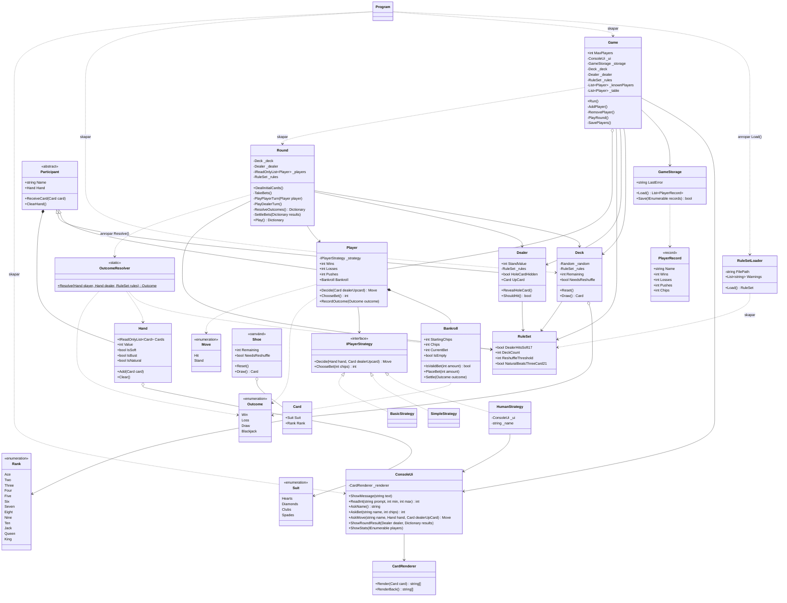

# Tjugoett

Grupp 7. Konsolspel i C# där 1-5 spelare spelar tjugoett mot en givare.

## Starta programmet

Kräver .NET 10.

```
dotnet run
```

## Arbetssätt

- `dev` är vår main. All kod kommer in via PR med 1 godkännande.
- En branch per kort, t.ex. `feature-hand-value`, skapad från `dev`.
- En klass per fil.

## Klassöversikt
- `Program` - skapar den enda `Random` i programmet, läser in husreglerna och startar `Game`.
- `Game` - menyn och spelloopen. Lägger till och tar bort spelare, startar en `Round` per giv och sparar spelarna efter varje runda. Val 5 sätter en datorspelare vid bordet och låter en välja vilken strategi den ska ha.
- `Hand` - korten en deltagare har. Räknar ut värdet varje gång det efterfrågas och vet om handen är mjuk, spräckt eller naturlig tjugoett.
- `Dealer` - ärver `Participant`. Har hålkortet. Dealer går sen via RuleSet för att se ifall den ska köpa på soft 17.
- `ConsoleUi` - all in- och utmatning. Visar händer och resultat, frågar och validerar svar.
- `CardRenderer` - ritar ett kort som rader text (`string[]`), så att `ConsoleUi` kan skriva ut flera kort bredvid varandra.
- `GameStorage` - sparar och läser spelarna i `players.json`.
- `PlayerRecord` - det som sparas om en spelare mellan körningar: namn, vinster, förluster, lika och marker.
- `SimpleStrategy` – en datorspelare som köper tills den har 17 eller mer. Den bryr sig inte om vad givaren har.
- `BasicStrategy` – en datorspelare som följer grundstrategin. Den kollar sin hand, om den är mjuk eller hård, och vilket kort givaren visar, och läser sedan av vad den ska göra i en tabell.
- `Game` – menyn och spelloopen. Jag lade till val 5 så att man kan sätta en datorspelare vid bordet och välja vilken strategi den ska ha. 
- `Move` – de två drag en spelare kan göra: köpa eller stanna. (små ändringar)
- `Outcome` – hur en runda slutade för en spelare: vinst, förlust, lika eller naturlig tjugoett.
- `OutcomeResolver` – jämför spelarens hand med givarens och avgör vem som vann. Följer tabellen i reglerna, så att den som spräcker alltid förlorar. Naturlig tjugoett slår 21 på tre kort om `NaturalBeatsThreeCard21` är sant, annars blir det lika.
- `Bankroll` – håller koll på en spelares marker och insats. Den drar insatsen när man satsar och betalar ut efter rundan: vinst 1:1, naturlig tjugoett 3:2 och lika ger insatsen tillbaka.
- `Round` – jag lade till att alla spelare satsar innan korten delas ut, och att insatserna betalas ut när rundan är avgjord. (ändringar) Round tar inn reglerna också och följer de. 
- `Game` – jag lade till att en spelare som får slut på marker lämnar bordet och inte kan sätta sig igen, och att markerna sparas tillsammans med resten. (ändringar)
- `RuleSet` - Detta är husreglerna som objekt som dealer hit on soft 17, hur mångra kortlekar, när de ska blandas om och  naturlig 21 vs 3 eller flera korts 21. 
- `RuleSetLoader` - Läser in `rules.txt` och ger en key and value på det som fyller i ett ruleset. Om de är fel på txt filen eller den finns inte så startar programet endån. 
- `Deck` - kortleken. Bygger `DeckCount` lekar med 52 kort, blandar dem och delar ut ett kort i taget. Blandas om inför en runda när det är färre än `ReshuffleThreshold` kort kvar.

## Klassdiagram


Det här bör du kontrollera:


## Vem gjorde vad

|  Namn  | Tillval | Del av grunden |
| ------ | ------- | -------------- |
| Ismail | 1       | `Card`, `Deck`, `Hand`, `Dealer` `ConsoleUi`, `Game`, `GameStorage`, `PlayerRecord`, `Program`|
| Albin  | 2       | `Move`, `IPlayerStrategy`, `Player`, `Game` |
| Ayaan  | 4       | `Move`, `Outcome`, `OutcomeResolver` |
| Adrian | 3       | `Round`, `rules`, `RuleSet`, RuleSetLoader`, `Program`|


## Avvikelser från reglerna

- Naturlig tjugoett ska betala 3:2, men vi räknar med heltal. Vid udda insats avrundas vinsten nedåt, så en insats på 5 ger 7 i stället för 7,5.
- En spelare som har slut på marker får inte sätta sig vid bordet igen, inte ens efter omstart. Reglerna säger bara att spelaren lämnar bordet, så det här är vårt val.

## Kända brister

- En känd brist är att man inte kan ändra rules när man kör programet. Man behöver ändra de i rules.txt filen innan man startar nästa program. 
- En spelare med 0 marker kan aldrig spela igen med samma namn. Det finns inget sätt att köpa nya marker.
- Försäkring (frivilligt i tillval 4) är inte gjord.
- Det finns inga automatiska tester. Utbetalningar och vem som vinner har bara testats genom att spela.
